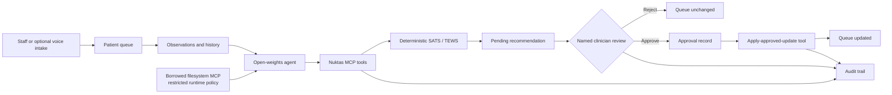

# Nuktas

Governed, SATS-grounded triage support for hospital and clinic teams.

Nuktas helps a clinical team collect observations, prioritize a waiting queue,
review an agent's evidence, and record a named clinician decision. The agent can
recommend a priority; it cannot silently diagnose, prescribe, or move a patient
in the queue.

This repository is a finalist submission for the **African Agentic AI Design
Challenge — Healthcare: The Triage Desk**.

## Start locally

```bash
git clone https://github.com/karanidenis/Nuktas.git
cd Nuktas
colima start --cpu 4 --memory 10 --disk 60
docker compose up --build -d
```

Open [http://localhost](http://localhost) and sign in with
`doctor@nairobi.clinic` / `password123`. The first run downloads approximately
10 GB of open-weights models, so it can take 20–30 minutes. See the
[detailed local setup](#detailed-local-setup-with-colima) for health checks,
other demo roles, and a reproducible agent run.

## What Nuktas does

Emergency and outpatient teams often coordinate intake through paper, phone
calls, spreadsheets, and disconnected systems. Nuktas provides one governed
workflow:

1. A patient enters the clinic queue through staff intake or the optional
   English/Swahili voice pilot.
2. Staff record or verify observations and vital signs.
3. The agent reads the current queue, patient history, and latest observations
   through clinic-scoped MCP tools.
4. Deterministic code applies the South African Triage Scale (SATS/TEWS). The
   language model does not invent the score.
5. Nuktas creates a **pending recommendation** with rationale, missing data,
   confidence, and the thresholds that fired.
6. A named clinician approves or rejects the recommendation.
7. Only the approval-gated MCP tool can apply an approved priority change.
8. Tool calls, recommendations, decisions, and queue changes are recorded in an
   append-only audit trail.

The web application is organized into three clinical workspaces:

- **Patient queue** — current load, urgency, patient overview, and visit actions.
- **Clinical review** — evidence and pending recommendations requiring a human
  decision.
- **Activity & audit** — agent runs, tool steps, audit events, and load trends.

## Decision boundary



| Control | Enforced by |
|---|---|
| Clinic and organization scope | Every Nuktas MCP tool |
| SATS/TEWS priority calculation | Deterministic JavaScript module |
| Queue-changing authority | `apply_approved_queue_update` only |
| Human decision | Named row in `approvals` |
| Agent tool policy | Restricted borrowed filesystem MCP |
| Traceability | Agent steps and append-only audit events |

Nuktas is decision support, not an autonomous clinician. It does not replace
local triage policy, professional judgment, emergency escalation procedures, or
medical-device validation.

## Detailed local setup with Colima

### Prerequisites

- macOS with [Colima](https://github.com/abiosoft/colima) and the Docker CLI
- Git
- At least 4 CPU cores, 8–10 GB RAM, and approximately 20 GB free disk space

No `.env` file is required for the local demonstration. Docker Compose supplies
safe demo defaults.

### 1. Clone and start

```bash
git clone https://github.com/karanidenis/Nuktas.git
cd Nuktas
colima start --cpu 4 --memory 10 --disk 60
docker compose up --build -d
```

The first run builds the application and downloads the open-weights LLM, ASR,
and TTS models. Depending on the connection, allow 20–30 minutes and roughly
10 GB of model downloads. Follow the model pull with:

```bash
docker compose logs -f ollama-init
```

When it reports that the model pull is complete, check the stack:

```bash
docker compose ps
curl http://localhost:4000/health
curl http://localhost:8100/health
curl http://localhost:8010/health
curl http://localhost:8011/health
```

### 2. Open the application

Open [http://localhost](http://localhost) and sign in with:

| Email | Password | Role |
|---|---|---|
| `admin@nairobi.clinic` | `password123` | Administrator |
| `staff@nairobi.clinic` | `password123` | Triage staff |
| `doctor@nairobi.clinic` | `password123` | Clinician |

The database schema and synthetic Nairobi clinic records are created
automatically. These credentials are for local demonstration only.

### 3. Walk through the product

1. Open **Patient queue** and select a patient.
2. Review the current visit, complaint, urgency, and visit history in one view.
3. Use the footer action to check in, begin, or complete the visit.
4. Open **Clinical review** to inspect pending SATS recommendations and record a
   clinician decision.
5. Open **Activity & audit** and select **Run scenario**. The synthetic busy-
   morning demonstration records healthy baseline observations, proves the MCP
   safety boundary rejects an impossible reading, records deterioration, and
   starts the governed agent.
6. Expand the resulting agent run to inspect every tool call, latency, model
   usage, safety decision, and clinician-review handoff.
7. In **Clinical review**, select the clinician's urgency and reason, then
   approve or reject. Return to **Activity & audit** to see concordance metrics,
   the recheck clock, and the deterministic **Handoff** and **FHIR** exports.
   Approved synthetic assessments are also mirrored asynchronously into the
   local HAPI FHIR R4 server at `http://localhost:8080/fhir`.

The scenario uses synthetic records only and never changes priority without a
named clinician. See [docs/FINALIST_SHOWCASE_SPEC.md](docs/FINALIST_SHOWCASE_SPEC.md)
for scope, non-goals, and acceptance criteria.

To create a fresh recommendation through the API, install `jq` and run:

```bash
LOGIN=$(curl -s http://localhost:4000/api/auth/login \
  -H 'Content-Type: application/json' \
  -d '{"email":"doctor@nairobi.clinic","password":"password123"}')

TOKEN=$(printf '%s' "$LOGIN" | jq -r '.token')
CLINIC_ID=$(printf '%s' "$LOGIN" | jq -r '.user.clinic_id')
QUEUE=$(curl -s "http://localhost:4000/api/v1/clinics/$CLINIC_ID/queue" \
  -H "Authorization: Bearer $TOKEN")
PATIENT_ID=$(printf '%s' "$QUEUE" | jq -r '.queue[0].patient.id')
QUEUE_ENTRY_ID=$(printf '%s' "$QUEUE" | jq -r '.queue[0].id')
CHIEF_COMPLAINT=$(printf '%s' "$QUEUE" | jq -r '.queue[0].chief_complaint')

curl -s "http://localhost:4000/api/v1/clinics/$CLINIC_ID/triage/runs" \
  -H "Authorization: Bearer $TOKEN" \
  -H 'Content-Type: application/json' \
  -d "$(jq -n \
    --arg patient_id "$PATIENT_ID" \
    --arg queue_entry_id "$QUEUE_ENTRY_ID" \
    --arg chief_complaint "$CHIEF_COMPLAINT" \
    '{patient_id:$patient_id,queue_entry_id:$queue_entry_id,chief_complaint:$chief_complaint,language:"en",trigger:"dashboard"}')"
```

Watch the run with `docker compose logs -f agent`, then refresh **Clinical
review**. Approval records the signed-in clinician and applies the update through
the gated MCP tool; rejection leaves the queue unchanged.

### Stop or reset

```bash
docker compose down
```

To delete all local Nuktas data and downloaded model volumes and start clean:

```bash
docker compose down -v
```

The second command is destructive and removes the local demonstration database
and model caches.

## Services started by Docker Compose

| Service | Local address | Purpose |
|---|---|---|
| Web client | `http://localhost` | Queue, review, and audit workspaces |
| Node API | `http://localhost:4000` | Authentication, workflow API, and Socket.IO |
| Agent | `http://localhost:8100` | Pydantic AI orchestration |
| ASR | `http://localhost:8010` | Optional Swahili speech recognition |
| TTS | `http://localhost:8011` | Optional Swahili speech output |
| Ollama | `http://localhost:11434` | Local open-weights model runtime |
| Hosted-MCP preview | `http://localhost:8200/mcp` | Loopback-only HTTP MCP transport |
| PostgreSQL | `127.0.0.1:5432` | Clinical workflow and audit state |

PostgreSQL and the local HTTP MCP preview are bound to loopback by default.

## Use an existing open-weights model endpoint

The default stack downloads `qwen2.5:7b-instruct` through Ollama. To use an
existing OpenAI-compatible vLLM, LocalAI, Ollama, or Qwen endpoint, create `.env`:

```bash
cp .env.example .env
```

Set at least:

```dotenv
LLM_BASE_URL=https://your-model-host.example/v1
LLM_CHAT_MODEL=your-open-weights-model
LLM_API_KEY=your-endpoint-key
LLM_DISABLE_THINKING=true
```

Then start with the external-model override, which skips the bundled Ollama
download:

```bash
docker compose -f docker-compose.yml -f docker-compose.external-llm.yml up --build -d
```

For real patient data, the database, model inference, transcripts, logs, and
backups must be deployed within the required legal and organizational boundary.
The public Render MCP is synthetic-only and is not evidence of production data
residency.

## MCP server

Nuktas exposes eight clinic-scoped tools:

| Tool | Type | Effect |
|---|---|---|
| `get_waiting_queue` | Read | Returns the active clinic queue |
| `get_latest_vitals` | Read | Returns the freshest observations |
| `get_patient_history` | Read | Returns scoped patient context and visits |
| `record_vitals` | Action | Validates and records observations |
| `assess_triage_priority` | Action | Creates a pending deterministic SATS recommendation |
| `flag_deterioration_for_review` | Action | Requests a governed second look |
| `request_clinician_approval` | Action | Places a recommendation in clinical review |
| `apply_approved_queue_update` | Gated action | Changes the queue only after named approval |

Hospitals can use this MCP server as a local sidecar without adopting the Nuktas
dashboard. See [MCP_INTEGRATION.md](MCP_INTEGRATION.md) for stdio and remote
configurations, the approval boundary, and current HIS/FHIR limitations.

### Public synthetic judge endpoint

```text
Current URL: https://nuktas-mcp-judge.onrender.com/mcp
Custom domain: https://mcp.nuktas.robopotato.co/mcp (after Render verifies TLS)
Transport: Streamable HTTP
Authentication: Authorization: Bearer <judge token>
```

The endpoint contains synthetic records only. Request the rotating judge token
from the Nuktas team; it is never committed to this repository.

Example MCP host configuration:

```json
{
  "mcpServers": {
    "nuktas-judge": {
      "url": "https://nuktas-mcp-judge.onrender.com/mcp",
      "headers": {
        "Authorization": "Bearer ${NUKTAS_MCP_TOKEN}"
      }
    }
  }
}
```

Verify a deployment with the official MCP client included in this repository:

```bash
export MCP_URL=https://nuktas-mcp-judge.onrender.com/mcp
export MCP_REMOTE_TOKEN='your-private-judge-token'
npm --prefix mcp-server ci
npm --prefix mcp-server run smoke:remote
unset MCP_REMOTE_TOKEN
```

The expected result lists all eight tools and reports one synthetic queue entry.
Render free PostgreSQL databases expire after 30 days, so the judge sandbox must
be recreated or upgraded before that deadline.

## Architecture

| Component | Technology | Responsibility |
|---|---|---|
| `client/` | React, TypeScript, Chakra UI | Clinical workspaces and real-time updates |
| `server/` | Node.js, Express, Socket.IO | Authenticated workflow API and clinician decisions |
| `agent/` | Python, FastAPI, Pydantic AI | Open-weights agent orchestration and step logging |
| `mcp-server/` | Node.js, MCP SDK | Scoped tools, deterministic SATS, approval gate |
| `protocols/` | Markdown policy | Runtime policy loaded through borrowed MCP |
| `asr/` | FastAPI, Whisper | Optional English/Swahili voice pilot |
| `tts/` | FastAPI, MMS/Chatterbox | Optional spoken responses |
| PostgreSQL | PostgreSQL 16 | Queue, observations, recommendations, approvals, audit |

The agent uses two MCP servers:

- **Owned MCP:** the Nuktas triage server above.
- **Borrowed MCP:** the official `@modelcontextprotocol/server-filesystem`,
  restricted to `protocols/`, used to load the runtime triage policy.

See [ARCHITECTURE.md](ARCHITECTURE.md) for component and trust-boundary detail,
and [docs/ADR-001-hosted-mcp.md](docs/ADR-001-hosted-mcp.md) for the hosted MCP
decision.

## Configuration

The complete template is [.env.example](.env.example). Common overrides are:

| Variable | Purpose | Local default |
|---|---|---|
| `JWT_SECRET` | Signs staff sessions | Demo value in Compose |
| `AGENT_SERVICE_TOKEN` | Authenticates agent callbacks | Demo value in Compose |
| `LLM_BASE_URL` | OpenAI-compatible model base URL | Bundled Ollama |
| `LLM_CHAT_MODEL` | Agent/intake model name | `qwen2.5:7b-instruct` |
| `LLM_API_KEY` | Model endpoint credential | `ollama` |
| `EMBED_BASE_URL` | Optional in-country embedding endpoint | Keyword search fallback |
| `TTS_ENGINE` | `mms` for CPU or `chatterbox` for GPU | `mms` |
| `MCP_REMOTE_TOKEN` | Protects Streamable HTTP MCP | Demo-only local value |
| `MCP_ALLOWED_HOSTS` | HTTP Host allow-list | `localhost,127.0.0.1` |
| `MODEL_COST_PER_1M_TOKENS` | Optional estimate shown in demo metrics | Unset / self-hosted |
| `FHIR_PUBLIC_BASE_URL` | Public identity used in FHIR Bundle links | `http://localhost:8080/fhir` |
| `FHIR_SERVER_TOKEN` | Optional bearer token for a remote FHIR server | Unset locally |

Never use the Compose defaults for a public or clinical deployment.

## Tests and verification

```bash
# MCP governance, SATS boundaries, HTTP authentication, and tool discovery
npm --prefix mcp-server test

# Agent policy and configuration tests
cd agent
PYTHONPATH=src .venv/bin/python -m pytest tests -q
cd ..

# Production client build
npm --prefix client run build

# Validate Compose definitions
docker compose config --quiet
docker compose -f docker-compose.mcp-judge.yml config --quiet
```

Current verified baseline:

- MCP: 30 passing tests
- Server interoperability: 2 passing FHIR Bundle tests
- Agent: 13 passing tests
- Client: production build passes
- FHIR Bundle: collection identity and transaction-idempotency tests pass
- HAPI FHIR R4: live transaction and resource-search verification passes
- Production MCP dependencies: 0 known audit vulnerabilities at last check

Evaluation cases, expected outcomes, pass/fail status, and the intentionally
unfixed safety case are documented in [EVALS.md](EVALS.md).

## Voice intake status

Voice intake remains an optional English/Swahili pilot and is deliberately not
the core product claim. It should be promoted only after facility testing shows
that it improves complaint completeness or intake time without increasing
correction burden in real clinic noise. The routes remain available for
research, but the primary workflow is staff queue → governed recommendation →
clinician review.

See [docs/ADR-002-voice-intake-positioning.md](docs/ADR-002-voice-intake-positioning.md).

## Known limitations

- This is a hackathon prototype, not a certified medical device.
- The hosted Render MCP uses synthetic data and free-tier infrastructure.
- Production hospital integration still needs tenant-bound OAuth, key rotation,
  retention controls, and a facility-specific FHIR/HL7/HIS adapter.
- Real deployment requires in-boundary model inference and operational evidence
  for data residency.
- Voice intake needs structured usability testing with nurses and patients.
- The documented under-triage omission case in [EVALS.md](EVALS.md) remains an
  explicit safety gap to resolve before clinical use.

## Further documentation

- [Architecture](ARCHITECTURE.md)
- [Evaluation evidence](EVALS.md)
- [MCP integration guide](MCP_INTEGRATION.md)
- [FHIR R4 integration guide](FHIR_INTEGRATION.md)
- [Hosted MCP decision](docs/ADR-001-hosted-mcp.md)
- [Voice intake positioning](docs/ADR-002-voice-intake-positioning.md)

## License

Apache 2.0. See [LICENSE](LICENSE).
